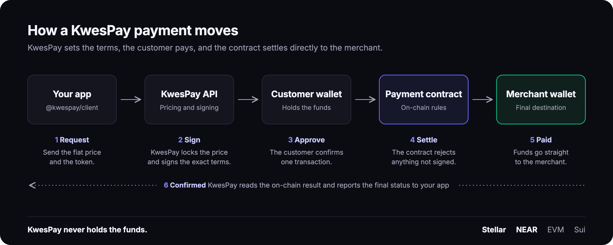

# @kwespay/client

Accept crypto priced in fiat on **Stellar**, **NEAR** and EVM networks with one TypeScript call. KwesPay sets the price and signs the terms, the customer's wallet pays, and the contract settles directly to the merchant.



| Chain | Network keys | Assets | Wallet |
| --- | --- | --- | --- |
| **Stellar** | `stellarTestnet`, `stellarMainnet` | XLM, USDC | `StellarWalletAdapter` |
| **NEAR** | `nearTestnet` | NEAR, USDC, USDC.e, USDT | `NearWalletAdapter` |
| **NEAR Intents** | Delivered to the merchant's network | Any token NEAR Intents supports | Any wallet or exchange |
| EVM | `ethereum`, `base`, `polygon`, `arbitrum`, `lisk`, and testnets | Native coin, USDC, USDT | EIP-1193 provider |
| Sui | `suiTestnet` | SUI, USDC | `SuiWalletAdapter` |

## Install

```bash
npm install @kwespay/client
```

Create a merchant at [app.kwespay.xyz](https://app.kwespay.xyz), or [app.testnet.kwespay.xyz](https://app.testnet.kwespay.xyz) for testnet, and generate an API key. Full guides are at [docs.kwespay.xyz](https://docs.kwespay.xyz).

## Stellar

Run a real XLM or USDC payment on Stellar Testnet from Node.

**You need:** a testnet API key, a merchant with Stellar Testnet enabled and a Stellar wallet set, and a payer account [funded with Friendbot](https://developers.stellar.org/docs/tools/lab/account). To pay in USDC, the payer also needs a USDC trustline and a balance.

```bash
npm install @kwespay/client @stellar/stellar-sdk
```

```js
// pay.mjs
import { KwesPayClient, KwesPayError } from "@kwespay/client";
import { Keypair, Networks, TransactionBuilder } from "@stellar/stellar-sdk";

const keypair = Keypair.fromSecret(process.env.STELLAR_SECRET);

const wallet = {
  getAddress: async () => keypair.publicKey(),
  signTransaction: async (xdr) => {
    const tx = TransactionBuilder.fromXDR(xdr, Networks.TESTNET);
    tx.sign(keypair);
    return tx.toXDR();
  },
};

const client = new KwesPayClient({
  apiKey: process.env.KWESPAY_API_KEY,
  graphqlEndpoint: "https://api.testnet.kwespay.xyz/graphql",
});

try {
  const result = await client.checkout({
    amount: 1,
    currency: "USD",
    token: process.argv[2] ?? "XLM",
    network: "stellarTestnet",
    orderId: `demo-${Date.now()}`,
    wallet,
    onStatus: (title, detail) => console.log(`${title}: ${detail}`),
  });
  console.log(result);
} catch (err) {
  if (err instanceof KwesPayError) console.error(err.code, err.message);
  else throw err;
  process.exitCode = 1;
}
```

```bash
KWESPAY_API_KEY=... STELLAR_SECRET=S... node pay.mjs XLM
KWESPAY_API_KEY=... STELLAR_SECRET=S... node pay.mjs USDC
```

`result` is typed as `CheckoutResult`:

```ts
{ paid: boolean; status: TransactionStatus; transactionReference: string; txHash: string;
  orderId: string | null; network: NetworkKey; token: string; cryptoAmount: number }
```

**In the browser**, pass any wallet that matches `StellarWalletAdapter`. With Freighter:

```ts
import { getAddress, signTransaction } from "@stellar/freighter-api";
import type { StellarWalletAdapter } from "@kwespay/client";

const wallet: StellarWalletAdapter = { getAddress, signTransaction };
```

**Configuration on Stellar Testnet**

| | |
| --- | --- |
| API endpoint | `https://api.testnet.kwespay.xyz/graphql` |
| Network key | `stellarTestnet` |
| Network passphrase | `Test SDF Network ; September 2015` |
| Payment contract | `CBS6TTZ56NSZLH2PSGA4VHNEBDX6JQV3S2J36KVKTWJ55TK7RN2U7IS5` |
| XLM | `CDLZFC3SYJYDZT7K67VZ75HPJVIEUVNIXF47ZG2FB2RMQQVU2HHGCYSC`, 7 decimals |
| USDC | `CBIELTK6YBZJU5UP2WWQEUCYKLPU6AUNZ2BQ4WWFEIE3USCIHMXQDAMA`, 7 decimals |
| Platform fee | 1%, added on top. Read it as `totalBaseUnits - amountBaseUnits` |
| `payload.deadline` | A ledger sequence, not a timestamp |

**Errors** are thrown as `KwesPayError` with a `code`:

| Code | Meaning |
| --- | --- |
| `INVALID_KEY` | The API key is missing, invalid or inactive |
| `NETWORK_NOT_ENABLED` | The merchant hasn't enabled this network or set a wallet for it |
| `TOKEN_NOT_SUPPORTED` | The merchant doesn't accept this token on this network |
| `QUOTE_EXPIRED` | The price lock ended. Request a new quote |
| `INSUFFICIENT_BALANCE` | The payer can't cover the total and fees |
| `WALLET_REJECTED` | The customer rejected the request in their wallet |
| `CONTRACT_ERROR` | The contract rejected the transaction. `message` has the reason |
| `NETWORK_ERROR` | The KwesPay API couldn't be reached |

Confirm every order on your server before fulfilling it:

```ts
const check = await client.verifyPayment(result.transactionReference, {
  orderId: result.orderId,
  amount: 1,
  currency: "USD",
});
if (check.paid) await fulfilOrder();
```

## NEAR

Run payments on NEAR Testnet through `pay.kwespay.testnet`. Native NEAR, Circle USDC, USDC.e and USDT are supported.

NEAR payments take a `NearWalletAdapter`: any object with `getAccounts()` and `signAndSendTransaction()`. That's the shape of a [`@near-wallet-selector`](https://github.com/near/wallet-selector) wallet. Since wallet-selector v10 expects `near-api-js` actions, wrap the wallet once with `internalActionToNaj`:

```typescript
import { KwesPayClient, type NearWalletAdapter } from "@kwespay/client";
import { setupWalletSelector, internalActionToNaj } from "@near-wallet-selector/core";
import { setupMeteorWallet } from "@near-wallet-selector/meteor-wallet";

const selector = await setupWalletSelector({ network: "testnet", modules: [setupMeteorWallet()] });
const wallet = await selector.wallet("meteor-wallet");
const [{ accountId }] = await wallet.signIn({ contractId: "pay.kwespay.testnet", methodNames: [] });

const nearWallet: NearWalletAdapter = {
  getAccounts: async () => [{ accountId }],
  signAndSendTransaction: (tx) => wallet.signAndSendTransaction({ ...tx, actions: tx.actions.map(internalActionToNaj) }),
};

const client = new KwesPayClient({ apiKey: "YOUR_API_KEY", graphqlEndpoint: "https://api.testnet.kwespay.xyz/graphql" });

const result = await client.checkout({
  amount: 50,
  currency: "GHS",
  token: "USDT",
  network: "nearTestnet",
  orderId: "A-1042",
  wallet: nearWallet,
});
```

What happens on NEAR:

- **Native NEAR** calls `pay_near` on the KwesPay contract with the total attached.
- **Stablecoins** (USDC, USDC.e, USDT) call `ft_transfer_call` on the token, which hands the signed terms to the KwesPay contract in the same transaction.
- The backend signs the payment for one customer account. `pay()` refuses a wallet signed in as a different account before anything is sent.
- `pay()` checks the customer's balance over public RPC first, and reports a refunded transfer as `CONTRACT_ERROR` with the contract's reason (for example an expired deadline).
- The KwesPay fee on NEAR is 1%. As on every chain, read it as `totalBaseUnits − amountBaseUnits`.
- `deadline` is in seconds; the contract receives `deadline × 1000` milliseconds.

The customer must be storage-registered on the token they pay with, which is true for any account that already holds it.

## Pay with any token through NEAR Intents

Customers can pay with any token [NEAR Intents](https://near-intents.org) supports, and the merchant receives the asset they accept. KwesPay verifies the delivery on-chain before the order counts as paid.

```typescript
const { quote, options } = await client.getCrossChainOptions({
  amount: 25, currency: "USD", token: "YOUR_TOKEN", network: "MERCHANT_NETWORK",
});
const option = options.find((o) => o.available);

const result = await client.checkoutFromAnotherAsset({
  quote,
  originAsset: option.originAsset,
  refundAddress: customerAddress,
  orderId: "A-1042",
  onDeposit: (route) => showDeposit(route.depositAddress, route.depositMemo, route.amountInFormatted),
  onStatus: (title, detail) => setProgress(title, detail),
});
```

- `options` lists every token with its live price, minimum and logos.
- `onDeposit` gives you what to show the customer. When `depositMemo` is set, it must be included.
- `refundAddress` is the customer's address on the chain they pay from.
- Confirm the order on your server with `verifyPayment()`. Webhooks work unchanged.

Merchants turn this on per network in the dashboard.

## EVM

In the browser, one call prices, signs, pays and waits for confirmation:

```typescript
import { KwesPayClient } from "@kwespay/client";

const client = new KwesPayClient({ apiKey: "your-api-key" });

const result = await client.checkout({
  amount: 10,
  currency: "USD",
  token: "USDC",
  network: "base",
  orderId: "A-1042",
  provider: window.ethereum,
});
```

On your server, one call confirms the order before you fulfil it:

```typescript
const check = await client.verifyPayment(result.transactionReference, {
  orderId: "A-1042",
  amount: 10,
  currency: "USD",
});

if (check.paid) await markOrderPaid("A-1042");
```

`verifyPayment` returns `paid: true` only when KwesPay confirmed the payment on-chain and it matches the order, amount and currency. Otherwise `reason` explains why. The vendor ID is optional when your API key belongs to one merchant.

## Reference

<details>
<summary>EVM wallet connection</summary>

`client.pay()` takes a wallet **provider**, not a private key — the SDK never touches keys and never signs anything itself. Every signature (token approval, the payment transaction) is requested through the wallet extension, which prompts the user and returns the signed, broadcast result. Your app's job is just to:

1. Detect an injected wallet (MetaMask, or any [EIP-1193](https://eips.ethereum.org/EIPS/eip-1193)-compatible provider)
2. Request the connected account (`eth_requestAccounts`)
3. Pass that address to `client.quote()`, and the provider itself to `client.pay()`

Everything else — chain switching, ERC-20 approval, transaction submission — happens automatically inside `pay()`.

### What triggers a wallet popup

| Step                | When it happens                                      | Skipped when                                                    |
| ------------------- | ---------------------------------------------------- | --------------------------------------------------------------- |
| Connect             | `eth_requestAccounts` is called                    | Wallet already connected to your site                           |
| Network switch      | Wallet is on the wrong chain for`payload.network`  | Wallet already on the correct chain                             |
| Token approval      | Paying with an ERC-20 and current allowance < amount | Paying with the native coin, or allowance is already sufficient |
| Payment transaction | Always, right before funds move                      | Never                                                           |

### Vanilla JavaScript

Works with plain `<script type="module">`, Vite, webpack, or any other bundler — no TypeScript required.

```html
<!DOCTYPE html>
<html>
  <body>
    <button id="connect">Connect Wallet</button>
    <button id="pay" disabled>Pay $10</button>
    <p id="status"></p>

    <script type="module">
      import { KwesPayClient, KwesPayError } from "@kwespay/client";

      const client = new KwesPayClient({ apiKey: "your-api-key" });

      const connectBtn = document.getElementById("connect");
      const payBtn = document.getElementById("pay");
      const statusEl = document.getElementById("status");

      let walletAddress = null;

      function shortAddress(addr) {
        return `${addr.slice(0, 6)}…${addr.slice(-4)}`;
      }

      async function connectWallet() {
        if (!window.ethereum) {
          alert("No wallet found. Install MetaMask: https://metamask.io/download");
          return;
        }

        try {
          const accounts = await window.ethereum.request({
            method: "eth_requestAccounts",
          });
          walletAddress = accounts[0];
          connectBtn.textContent = shortAddress(walletAddress);
          payBtn.disabled = false;
        } catch (err) {
          // 4001 is the standard EIP-1193 "user rejected request" code.
          statusEl.textContent =
            err.code === 4001
              ? "Connection request rejected."
              : `Failed to connect: ${err.message}`;
        }
      }

      // Keep the UI in sync if the user switches accounts or disconnects
      // from inside the wallet itself, rather than through your app.
      window.ethereum?.on("accountsChanged", (accounts) => {
        walletAddress = accounts[0] ?? null;
        payBtn.disabled = !walletAddress;
        connectBtn.textContent = walletAddress
          ? shortAddress(walletAddress)
          : "Connect Wallet";
      });

      async function payNow() {
        payBtn.disabled = true;
        try {
          const payload = await client.quote({
            vendorIdentifier: "your-vendor-id",
            fiatAmount: 10,
            fiatCurrency: "USD",
            cryptoCurrency: "USDC",
            network: "base",
            payerWalletAddress: walletAddress,
          });

          // pay() prompts the wallet for approval (if needed) and the
          // payment transaction itself — both are real signatures the
          // user confirms in MetaMask.
          const result = await client.pay({
            provider: window.ethereum,
            payload,
            onStatus: (title, detail) => {
              statusEl.textContent = `${title}: ${detail}`;
            },
          });

          statusEl.textContent = `Paid! Tx: ${result.txHash}`;
        } catch (err) {
          statusEl.textContent =
            err instanceof KwesPayError
              ? `[${err.code}] ${err.message}`
              : String(err);
        } finally {
          payBtn.disabled = false;
        }
      }

      connectBtn.addEventListener("click", connectWallet);
      payBtn.addEventListener("click", payNow);
    </script>
  </body>
</html>
```

> **No bundler?** Load the pre-built browser bundle directly from a CDN:
>
> ```html
> <script src="https://cdn.jsdelivr.net/npm/@kwespay/client/dist/browser/kwespay.js"></script>
> <script>
>   const client = new KwesPay.KwesPayClient({ apiKey: "your-api-key" });
>   // same connectWallet() / payNow() code as above, using `KwesPay.KwesPayError`
> </script>
> ```
>
> The CDN build only covers EVM networks. Sui and Stellar payments dynamically load `@mysten/sui` / `@stellar/stellar-sdk`, which requires a bundler that can resolve npm packages — see [Non-EVM wallets](#non-evm-wallets-sui--stellar--near) below.

### React

```tsx
import { useState, useCallback, useEffect } from "react";
import { KwesPayClient, KwesPayError } from "@kwespay/client";

const client = new KwesPayClient({ apiKey: "your-api-key" });

function useWallet() {
  const [address, setAddress] = useState<string | null>(null);
  const [connecting, setConnecting] = useState(false);
  const [error, setError] = useState<string | null>(null);

  const connect = useCallback(async () => {
    if (!window.ethereum) {
      setError("No wallet found. Install MetaMask.");
      return;
    }
    setConnecting(true);
    setError(null);
    try {
      const accounts = (await window.ethereum.request({
        method: "eth_requestAccounts",
      })) as string[];
      setAddress(accounts[0]);
    } catch (err: any) {
      setError(err?.code === 4001 ? "Connection rejected." : err.message);
    } finally {
      setConnecting(false);
    }
  }, []);

  // React never sees wallet-side account/network changes on its own —
  // this keeps `address` correct if the user switches accounts in MetaMask.
  useEffect(() => {
    if (!window.ethereum) return;
    const onAccountsChanged = (accounts: string[]) =>
      setAddress(accounts[0] ?? null);
    window.ethereum.on("accountsChanged", onAccountsChanged);
    return () => window.ethereum?.removeListener("accountsChanged", onAccountsChanged);
  }, []);

  return { address, connect, connecting, error };
}

export function PayButton() {
  const { address, connect, connecting, error } = useWallet();
  const [status, setStatus] = useState<string | null>(null);
  const [paying, setPaying] = useState(false);

  const pay = useCallback(async () => {
    if (!address) return;
    setPaying(true);
    try {
      const payload = await client.quote({
        vendorIdentifier: "your-vendor-id",
        fiatAmount: 10,
        fiatCurrency: "USD",
        cryptoCurrency: "USDC",
        network: "base",
        payerWalletAddress: address,
      });

      const result = await client.pay({
        provider: window.ethereum,
        payload,
        onStatus: (title, detail) => setStatus(`${title}: ${detail}`),
      });

      setStatus(`Paid! Tx: ${result.txHash}`);
    } catch (err) {
      setStatus(err instanceof KwesPayError ? `[${err.code}] ${err.message}` : String(err));
    } finally {
      setPaying(false);
    }
  }, [address]);

  if (!address) {
    return (
      <div>
        <button onClick={connect} disabled={connecting}>
          {connecting ? "Connecting…" : "Connect Wallet"}
        </button>
        {error && <p style={{ color: "red" }}>{error}</p>}
      </div>
    );
  }

  return (
    <div>
      <button onClick={pay} disabled={paying}>
        {paying ? "Processing…" : "Pay $10"}
      </button>
      {status && <p>{status}</p>}
    </div>
  );
}
```

> **Production tip:** prefer a wallet-connection library — [wagmi](https://wagmi.sh/), [RainbowKit](https://www.rainbowkit.com/), or [Web3Modal](https://web3modal.com/) — over hand-rolled `window.ethereum` calls. They handle multi-wallet detection ([EIP-6963](https://eips.ethereum.org/EIPS/eip-6963), since several extensions can inject `window.ethereum` at once), WalletConnect/mobile deep links, and reconnect-on-refresh for you. Whichever you use, the integration point with KwesPay stays identical: get an EIP-1193 `provider` and an `address`, then call `client.quote()` and `client.pay()` exactly as above.

### TypeScript and `window.ethereum`

TypeScript doesn't know about `window.ethereum` out of the box. Declare it once, project-wide, in a `global.d.ts`:

```typescript
import type { EIP1193Provider } from "@kwespay/client";

declare global {
  interface Window {
    ethereum?: EIP1193Provider & {
      on(event: string, listener: (...args: any[]) => void): void;
      removeListener(event: string, listener: (...args: any[]) => void): void;
    };
  }
}
```

</details>

<details>
<summary>Sui wallets</summary>

Pass a `SuiWalletAdapter` as `wallet` on `client.pay()` or `client.checkout()`. The SDK picks the right flow from `payload.network`.

</details>

<details>
<summary>API methods</summary>

### `new KwesPayClient(config)`

Creates a new client instance.

| Parameter         | Type       | Required | Description          |
| ----------------- | ---------- | -------- | -------------------- |
| `config.apiKey` | `string` | Yes      | Your KwesPay API key |

---

### `client.checkout(params)`

Runs the whole payment: quote, balance check, signed transaction, wallet approval and payment, then waits for KwesPay's final status.

| Parameter | Required | Description |
| --- | --- | --- |
| `amount` | Yes | Price in fiat |
| `currency` | No | ISO 4217 code. Default `USD` |
| `token` | Yes | Token to pay with |
| `network` | Yes | Network key |
| `orderId` | No | Your order ID, checked by `verifyPayment()` |
| `provider` / `wallet` | Yes | EIP-1193 provider for EVM, wallet adapter for Stellar and Sui |
| `vendorIdentifier` | No | Only needed when the key can access more than one merchant |
| `onStatus` | No | `(title, detail) => void` progress callback |

**Returns** — `{ paid, status, transactionReference, txHash, orderId, network, token, cryptoAmount }`.

---

### `client.verifyPayment(transactionReference, { amount, currency, orderId? })`

For your server. Returns `{ paid, reason, status, orderId, fiatAmount, fiatCurrency, token, cryptoAmount, network, txHash, vendorIdentifier, initiatedAt }`. `amount` and `currency` are required so a cheaper payment can never be accepted for the order.

---

### `client.validateKey()`

Validates the configured API key and returns its scope.

```typescript
const result = await client.validateKey();

if (result.isValid) {
  console.log(result.vendorInfo);
  console.log(result.scope.allowedNetworks);
} else {
  console.error(result.error);
}
```

**Returns** — `{ isValid: true, keyId, keyLabel, activeFlag, expirationDate, vendorInfo, scope }` or `{ isValid: false, error }`.

---

### `client.quote(params)`

Fetches a price quote and prepares a transaction payload in a single call. The returned payload is passed directly to `client.pay()`.

```typescript
const payload = await client.quote({
  vendorIdentifier: "your-vendor-id",
  fiatAmount: 25.00,
  fiatCurrency: "USD",        // optional, defaults to "USD"
  cryptoCurrency: "USDC",
  network: "base",
  payerWalletAddress: "0xabc...",
});
```

| Parameter              | Type            | Required | Description                                                                                                     |
| ---------------------- | --------------- | -------- | --------------------------------------------------------------------------------------------------------------- |
| `vendorIdentifier`   | `string`      | Yes      | Your vendor UUID from[app.kwespay.xyz](https://app.kwespay.xyz)                                                  |
| `fiatAmount`         | `number`      | Yes      | Amount in fiat to charge                                                                                        |
| `fiatCurrency`       | `string`      | No       | ISO 4217 fiat currency code — see[Supported Fiat Currencies](#supported-fiat-currencies). Defaults to `"USD"` |
| `cryptoCurrency`     | `TokenSymbol` | Yes      | Token to accept                                                                                                 |
| `network`            | `NetworkKey`  | Yes      | Target blockchain network                                                                                       |
| `payerWalletAddress` | `string`      | Yes      | The payer's wallet address                                                                                      |

**Returns** — `TransactionPayload`

---

### `client.pay(params)`

Executes the on-chain payment. Handles network switching, token approval, and transaction submission automatically.

```typescript
const result = await client.pay({
  provider: window.ethereum,
  payload,
  onStatus: (title, detail) => {
    console.log(`[${title}] ${detail}`);
  },
});
```

| Parameter    | Type                        | Required | Description                    |
| ------------ | --------------------------- | -------- | ------------------------------ |
| `provider` | `EIP1193Provider`         | Yes      | Wallet provider                |
| `payload`  | `TransactionPayload`      | Yes      | Payload from`client.quote()` |
| `onStatus` | `(title, detail) => void` | No       | Progress callback              |

The `onStatus` callback fires at each stage of the payment flow:

| Title                        | Fired when                            |
| ---------------------------- | ------------------------------------- |
| `Checking balance`         | Verifying wallet has sufficient funds |
| `Switching network`        | Requesting network change in wallet   |
| `Checking approval`        | Reading current ERC-20 allowance      |
| `Approve token`            | Requesting ERC-20 approval from user  |
| `Waiting for approval`     | Approval tx is confirming on-chain    |
| `Confirm payment`          | Requesting payment tx from user       |
| `Waiting for confirmation` | Payment tx is confirming on-chain     |

**Returns** — `PaymentResult`

```typescript
interface PaymentResult {
  txHash: string;
  blockNumber: number;
  transactionReference: string;
  paymentIdBytes32: string;
}
```

---

### `client.getTransactionStatus(transactionReference)`

Polls the KwesPay backend for the current status of a transaction.

```typescript
const status = await client.getTransactionStatus("txn_ref_here");
console.log(status.transactionStatus); // "completed"
```

**Returns** — `TransactionStatusResult`

```typescript
interface TransactionStatusResult {
  transactionReference: string;
  transactionStatus: TransactionStatus;
  blockchainHash: string | null;
  blockchainNetwork: string | null;
  displayAmount: number;
  cryptoCurrency: string;
  payerWalletAddress: string;
  initiatedAt: string;
}
```

</details>

<details>
<summary>Network keys</summary>

| Key | Network |
| --- | --- |
| `stellarTestnet`, `stellarMainnet` | Stellar |
| `nearTestnet` | NEAR Testnet |
| `ethereum`, `sepolia` | Ethereum |
| `base`, `baseSepolia` | Base |
| `polygon`, `polygonAmoy` | Polygon |
| `arbitrum`, `arbitrumSepolia` | Arbitrum |
| `lisk`, `liskTestnet` | Lisk |
| `mezoTestnet` | Mezo Testnet |
| `suiTestnet` | Sui Testnet |

</details>

<details>
<summary>Fiat currencies</summary>

`fiatAmount`/`fiatCurrency` are quoted server-side against live FX rates, so `fiatCurrency` accepts any standard ISO 4217 code — it isn't limited to the list below. These are the currencies KwesPay actively supports for African markets:

| Code    | Currency            | Country      |
| ------- | ------------------- | ------------ |
| `USD` | US Dollar           | — (default) |
| `NGN` | Naira               | Nigeria      |
| `GHS` | Cedi                | Ghana        |
| `ZAR` | Rand                | South Africa |
| `KES` | Shilling            | Kenya        |
| `ZWG` | Zimbabwe Gold (ZiG) | Zimbabwe     |

```typescript
const payload = await client.quote({
  vendorIdentifier: "your-vendor-id",
  fiatAmount: 5000,
  fiatCurrency: "NGN",
  cryptoCurrency: "USDC",
  network: "base",
  payerWalletAddress: address,
});
```

`fiatCurrency` defaults to `"USD"` if omitted.

</details>

<details>
<summary>All error codes</summary>

| Code                     | Description                                       |
| ------------------------ | ------------------------------------------------- |
| `INVALID_KEY`          | API key is missing, invalid, or inactive          |
| `QUOTE_EXPIRED`        | Quote TTL has elapsed                             |
| `QUOTE_USED`           | Quote has already been used for a transaction     |
| `QUOTE_NOT_FOUND`      | Quote ID does not exist                           |
| `TRANSACTION_FAILED`   | Payload is missing required fields                |
| `WALLET_REJECTED`      | User rejected the transaction in their wallet     |
| `APPROVAL_REJECTED`    | User rejected the ERC-20 approval in their wallet |
| `INSUFFICIENT_BALANCE` | Wallet lacks funds or gas                         |
| `CONTRACT_ERROR`       | On-chain call reverted or receipt timed out       |
| `WRONG_NETWORK`        | Wallet is on the wrong chain and could not switch |
| `NETWORK_ERROR`        | HTTP or connectivity failure reaching the API     |
| `CROSS_CHAIN_UNAVAILABLE` | Paying with that asset isn't available for this payment |
| `AMOUNT_BELOW_MINIMUM` | The payment is below the asset's minimum          |
| `INVALID_REFUND_ADDRESS` | The refund address isn't valid for that chain  |
| `UNKNOWN`              | Unclassified server-side error                    |

</details>

<details>
<summary>TypeScript types</summary>

The SDK is written in TypeScript and ships its own types. No additional `@types` packages are required.

Key types exported from the package:

```typescript
import type {
  KwesPayConfig,
  QuoteParams,
  TransactionPayload,
  TransactionStatus,
  TransactionStatusResult,
  PayParams,
  PaymentResult,
  NetworkKey,
  TokenSymbol,
  EIP1193Provider,
  KwesPayErrorCode,
} from "@kwespay/client";
```

</details>

## License

MIT
